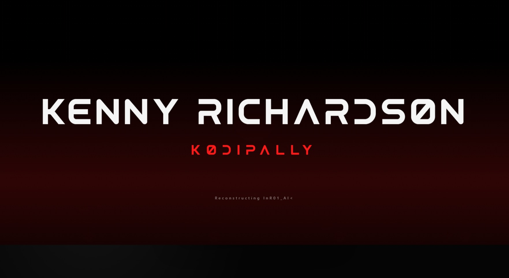
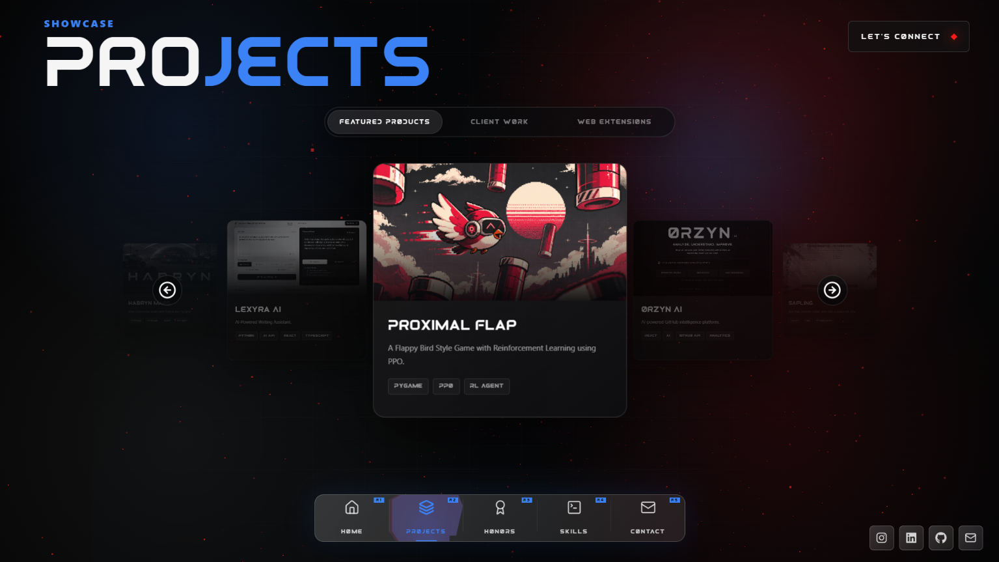
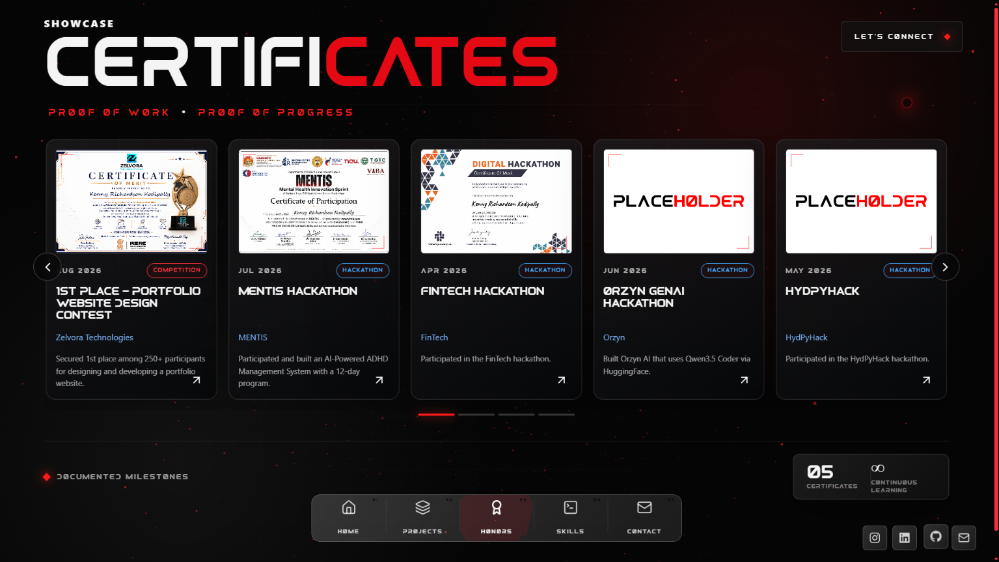
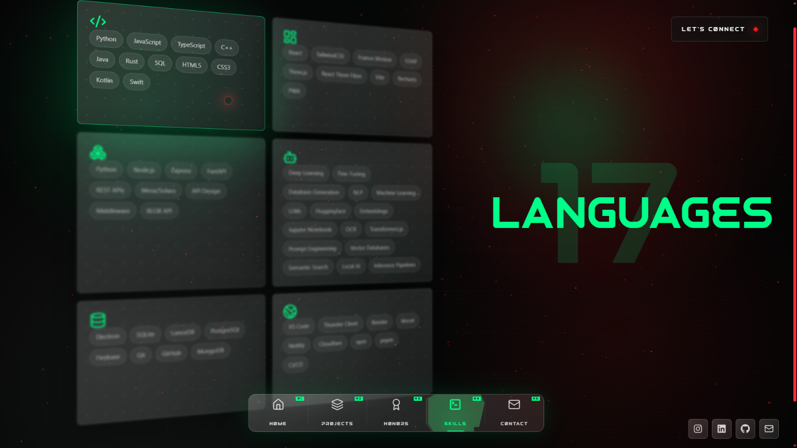
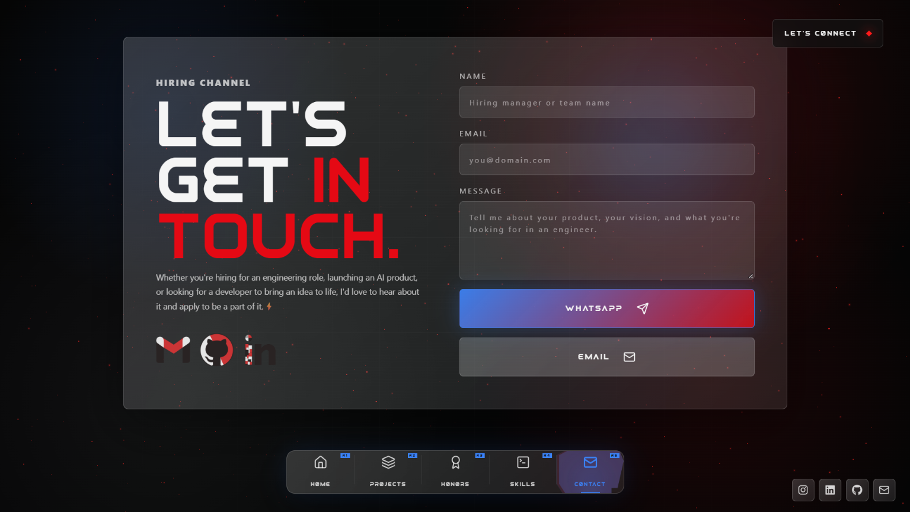

# 👋 Kenny Richardson

# 🚀 AI Engineer • Full-Stack Developer

Building intelligent software, developer tools, desktop applications, and immersive web experiences.

🌐 **Portfolio**
https://www.kennykrichardson.com

---

## ✨ About

This repository contains the complete source code for my personal portfolio website.

It showcases:

- 🤖 AI-powered projects
- 💻 Full-stack applications
- 🖥️ Desktop software
- 🎨 UI/UX experiments
- ⚡ Interactive web experiences
- 🚀 Commercial work

---

## 🛠 Tech Stack

### Frontend

- ⚛️ React
- 📘 TypeScript
- ⚡ Vite
- 🎨 Tailwind CSS
- 🎭 Framer Motion

### Graphics

- 🌌 Three.js
- 🎮 React Three Fiber
- ✨ React Three Drei

### Tools

- 🐙 Git
- ☁️ Render

---

## 🚀 Featured Projects

### 🐤 Proximal Flap - Autonomous Flight PPO

Proximal Flap is a Flappy Bird simulation featuring a PPO-trained reinforcement learning agent for autonomous flight, procedural obstacle generation and intelligent decision making.

### ✍️ Lexyra AI

An AI-powered writing assistant that transforms rough drafts into clear,
meaningful writing while preserving the writer's voice and tone.

### 🤖 Orzyn AI

A developer intelligence platform focused on repository analytics and
engineering insights.

### ♻️ Regenesis AI

A developer repository recreation platform designed to help reconstruct
useful project context.

### 🌍 Nyxora AI

A fine-tuned, LLM-powered world generator built to help writers explore
and create story worlds.

### 💸 Quartly

A personal finance tracker with modern analytics and budgeting features.

### 📊 Fluid Deck AI

An AI-powered PowerPoint parser exploring presentation intelligence and
document automation.

### 📸 FlashText

An OCR-powered application that extracts text from images.

------------------------------------------------------------------------

---

## Screenshots

### Intro Boot

### Nexus Page

### Projects Page

### Honors Page

### Skills Page

### Contact Page

## 📬 Contact

📧 **Email**

kennykrichardson@gmail.com

💼 **LinkedIn**

https://linkedin.com/in/kennykrichardson

🐙 **GitHub**

https://github.com/kennykrichardson

---

## © Copyright

This project is the intellectual property of Kenny Richardson.

All Rights Reserved.

The source code, design, assets, branding, and content may not be copied, redistributed, modified, or used without explicit written permission.

---

### ⭐ Thanks for visiting!

